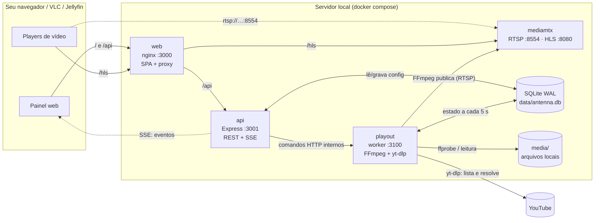
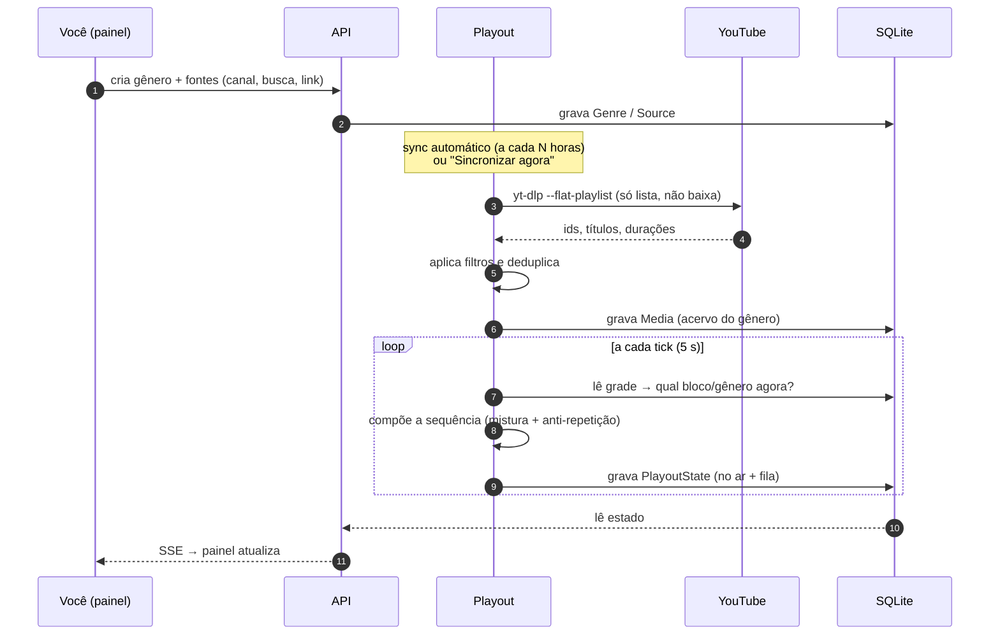
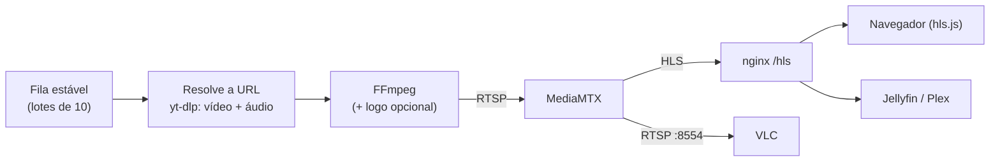

<p align="center">
  
</p>

<h1 align="center">Antenna</h1>
<h3 align="center">Seu próprio canal de TV, no ar 24 horas, no servidor da sua casa.</h3>

<p align="center">
  <a href="LICENSE"></a>
  
  
  
  
</p>

---

> [!NOTE]
> Projeto pessoal, de uso doméstico e aberto ao público, sem vínculo com o YouTube nem
> com o `yt-dlp`. Leia o [**aviso e isenção de responsabilidade**](#aviso-e-isenção-de-responsabilidade).

---

O **Antenna** é um sistema **self-hosted** que transforma vídeos do YouTube (via `yt-dlp`)
e arquivos locais em **um único canal de TV linear** na sua rede. Em vez de escolher o que
assistir, você liga o canal: ele decide sozinho o que vem a seguir, seguindo **gêneros** e
uma **grade semanal** que você monta — como uma emissora de verdade, só que sua.

O canal abre no navegador, no VLC ou como **canal de TV ao vivo no Jellyfin/Plex**, com
guia de programação (EPG). Um painel web controla tudo: o que está no ar, a fila, a grade,
as fontes e o logo da transmissão.

Não há contas, nuvem nem telemetria: sobe com um `docker compose up`, guarda tudo em um
arquivo SQLite e só conversa com o YouTube para buscar os vídeos.

**Quer rodar o seu?** Vá direto para a [instalação](#instalação-docker) — em poucos
minutos o canal está no ar.
**Achou um problema?** Abra uma [issue](../../issues) com os logs do container `playout`.
**Quer contribuir?** Leia o [`AGENTS.md`](AGENTS.md) e a seção [Desenvolvimento](#desenvolvimento).
**Entender as decisões?** Veja [`docs/PLANO.md`](docs/PLANO.md) e o [`design.md`](design.md).

---

## Sumário

- [O que ele faz](#o-que-ele-faz)
- [Como funciona](#como-funciona)
- [Componentes](#componentes)
- [O fluxo, passo a passo](#o-fluxo-passo-a-passo)
- [Conceitos do domínio](#conceitos-do-domínio)
- [Instalação (Docker)](#instalação-docker)
- [Usando o painel](#usando-o-painel)
- [Assistindo ao canal](#assistindo-ao-canal)
- [Configuração](#configuração)
- [Dados e backup](#dados-e-backup)
- [Operação e manutenção](#operação-e-manutenção)
- [Desenvolvimento](#desenvolvimento)
- [Estrutura do repositório](#estrutura-do-repositório)
- [Aviso e isenção de responsabilidade](#aviso-e-isenção-de-responsabilidade)
- [Segurança e uso responsável](#segurança-e-uso-responsável)
- [Solução de problemas](#solução-de-problemas)
- [Licença](#licença)

---

## O que ele faz

- **Canal linear contínuo**: o stream nunca "acaba". Um vídeo termina, o próximo já entra
  na sequência (com emenda sem vão), 24 horas por dia.
- **Gêneros com fontes automáticas**: um gênero (ex.: _Podcasts_, _Documentários_) reúne
  canais do YouTube, buscas e links avulsos. O Antenna sincroniza essas fontes sozinho e
  mantém o acervo atualizado — sem baixar os vídeos.
- **Mistura e anti-repetição**: defina quanto de cada fonte entra na sequência (ex.: 2 de
  um canal, 1 de outro) e quantos vídeos recentes **não** podem se repetir. Há ordenação
  por "menos reproduzidos", mais antigos ou aleatória.
- **Grade semanal (EPG)**: arraste blocos de horário para os dias da semana, cada um
  ligado a um gênero. Vários **perfis de grade** (ex.: "Semana normal", "Feriado").
- **Painel completo**: o que está no ar, fila dos próximos, pular, tocar agora, iniciar e
  parar, histórico de atividade, falhas e quarentenas.
- **Logo na transmissão**: marca d'água no próprio sinal (posição, tamanho e opacidade
  configuráveis), aparecendo igual em qualquer player.
- **Canal de TV para o Jellyfin/Plex**: expõe uma lista **M3U** e um guia **XMLTV**
  gerado da sua grade — o canal aparece na guia de TV ao vivo com a programação.
- **Resiliente**: classifica falhas (YouTube bloqueou? MediaMTX caiu? vídeo quebrado?),
  repete, coloca vídeo problemático em quarentena e se recupera sozinho.

## Como funciona



Três ideias de projeto sustentam tudo:

1. **Separar controle e exibição.** A API (painel/configuração) e o worker de playout
   (FFmpeg/yt-dlp) são processos distintos. Reiniciar ou quebrar o painel **nunca**
   derruba o stream; reiniciar o worker não perde o estado do painel.
2. **O banco é o ponto de encontro.** O worker grava o estado do canal a cada tick (5 s)
   numa linha única (`PlayoutState`) e a API apenas lê. Comandos (start, stop, pular…)
   vão da API ao worker por HTTP, numa rede interna do compose que não é publicada.
3. **Lógica de domínio pura e testada.** Escolha de vídeo, filtros, mistura, grade e EPG
   vivem em `packages/core` como funções puras com testes; os apps só orquestram I/O.

## Componentes

| Serviço (container) | Pasta | Papel |
| --- | --- | --- |
| **web** (`antenna-web`) | `apps/web` | Painel em React + Vite + Tailwind servido pelo **nginx**, que também é a **porta de entrada** (`:3000`): entrega a SPA, faz proxy de `/api` para a API e de `/hls` para o MediaMTX — tudo na mesma origem, sem CORS. |
| **api** (`antenna-api`) | `apps/api` | API REST + SSE (Express + TypeScript). CRUD de gêneros, fontes, grade, perfis, configurações; valida tudo com Zod; empurra eventos em tempo real ao painel; gera o M3U/XMLTV. |
| **playout** (`antenna-playout`) | `apps/playout` | O **worker de exibição**. Decide o que toca, resolve URLs via `yt-dlp`, roda o **FFmpeg** e publica no MediaMTX; sincroniza fontes do YouTube; trata falhas. Sem HTTP público — só um controle interno (`:3100`). |
| **mediamtx** (`antenna-mediamtx`) | `infra/mediamtx.yml` | Servidor de mídia. Recebe o stream do FFmpeg e o distribui como **HLS** (navegador, Jellyfin) e **RTSP** (VLC), mantendo o muxer HLS vivo durante as trocas de vídeo. |

Bibliotecas compartilhadas (workspaces npm):

| Pacote | O que contém |
| --- | --- |
| `packages/core` | **Domínio puro e testado**: `selection` (mistura, pools, anti-repetição), `filters` (filtros de fonte), `schedule` (bloco atual da grade), `epg` (XMLTV), `failures` (classificação/quarentena), `branding` (geometria do logo). |
| `packages/shared` | **Contrato Zod** único entre API e Web: todo input da API é validado aqui e o front usa os tipos inferidos. |
| `packages/database` | Schema Prisma + client (SQLite em modo WAL) e o script de migração do projeto antigo. |

Pastas de dados (montadas nos containers): `data/` (banco e logo) e `media/` (arquivos
locais, visível como `/media` no worker).

## O fluxo, passo a passo

### 1. Do conteúdo à fila



### 2. Do vídeo escolhido ao seu player



1. **Escolha.** A cada tick o worker verifica o bloco atual da grade. Se há um bloco, o
   gênero dele monta a "sequência viva" (mistura de fontes + janela anti-repetição). Sem
   bloco, entra a seleção automática; sem nada elegível, o _fallback_.
2. **Fila estável.** A sequência é gerada em lotes de 10 e consumida em ordem — a fila só
   é refeita quando o programa (bloco) muda, esvazia ou no boot. Isso evita a "fila que
   embaralha sozinha".
3. **Resolução.** Para vídeos do YouTube, o `yt-dlp` obtém as URLs diretas de vídeo e
   áudio; o FFmpeg lê as duas e remuxa/transcodifica (arquivos locais H.264 vão em _copy_).
4. **Publicação.** O FFmpeg publica por RTSP no MediaMTX, que serve HLS e RTSP.
5. **Emenda sem vão.** Ao trocar de vídeo, o MediaMTX mantém o muxer HLS vivo
   (`hlsAlwaysRemux`) — quem está assistindo não toma 404 nem reconecta.
6. **Falhas.** O worker classifica o erro (ver abaixo) e decide: repetir o mesmo item,
   pular, quarentenar ou apenas aguardar o MediaMTX voltar.

### 3. Como o painel fica em tempo real

O worker grava o estado a cada tick; a API detecta mudanças e emite eventos por **SSE**
(`/api/v1/events`). O painel (TanStack Query) invalida só as consultas afetadas — sem
polling agressivo. Por estar tudo no banco, o painel **sobrevive** a reinícios do worker.

### 4. Tratamento de falhas

| Causa | Exemplo | Reação |
| --- | --- | --- |
| **Infraestrutura** | MediaMTX inacessível | Repete o **mesmo** item; nunca vai para quarentena |
| **Do vídeo** | 403, URL não resolve, demux falhou | Até 3 tentativas; depois **quarentena de 24 h** (em memória, nunca apaga o vídeo) |
| **Transitória** | `Read error`, `Stream ends prematurely` | Só registra; o resume por _Range_ recupera |

Um _disjuntor_ marca o container como `unhealthy` após falhas seguidas de publicação.
O bloqueio do YouTube (bot-check) é transitório: o canal se recupera sozinho.

## Conceitos do domínio

- **Gênero** — um "canal temático" do acervo: nome, cor, ícone, ordenação padrão
  (`menos_reproduzidos`, `aleatoria`, `mais_antigos`, `definida`) e janela anti-repetição.
- **Fonte** — de onde vêm os vídeos de um gênero: **vídeo avulso**, **canal**, **busca**
  ou **busca dentro de um canal**. Cada fonte tem limite por sincronização, ordem
  (recentes/antigos) e **filtros** (palavras no título, duração, visualizações, data, sem Shorts, sem lives).
- **Mistura** — a "receita" da sequência: ingredientes que dizem quantos vídeos vêm de
  cada fonte, categoria ou do gênero todo antes de recomeçar o ciclo.
- **Programa / bloco** — um intervalo da grade (dia da semana + horário) ligado a um gênero.
  Blocos não cruzam a meia-noite, têm no mínimo 5 minutos e não podem se sobrepor.
- **Perfil de grade** — um conjunto completo de blocos; troque de perfil conforme o dia.
- **Fallback** — mídia de segurança quando não há nada elegível (`FALLBACK_MEDIA_ID`).
- **Quarentena** — afastamento temporário de um vídeo que falha repetidamente.

## Instalação (Docker)

**Requisitos:** um servidor (PC, mini-PC, NAS, Raspberry com Docker) com **Docker** e
**Docker Compose v2**, acesso à internet para o YouTube e, de preferência, uma máquina
com CPU razoável — vídeos do YouTube são **transcodificados** pelo FFmpeg.

```bash
git clone https://github.com/michelmlg/antenna.git
cd antenna
cp .env.example .env        # ajuste portas, fuso etc. (veja "Configuração")
docker compose up -d --build
```

Pronto — funciona igual em Linux, Windows e macOS. A primeira _build_ baixa FFmpeg e
yt-dlp e leva alguns minutos. O banco (`data/antenna.db`) é **criado automaticamente**
no primeiro boot da API; atualizações de schema também são aplicadas no boot.

| O quê | Endereço |
| --- | --- |
| Painel | `http://<ip-do-servidor>:3000` |
| HLS (mesma origem) | `http://<ip-do-servidor>:3000/hls/antenna/index.m3u8` |
| RTSP (VLC) | `rtsp://<ip-do-servidor>:8554/antenna` |
| Lista M3U (IPTV) | `http://<ip-do-servidor>:3000/api/v1/iptv/channels.m3u` |
| Guia XMLTV (EPG) | `http://<ip-do-servidor>:3000/api/v1/epg/guide.xml` |

Se mudar `CHANNEL`, `WEB_PORT` ou `RTSP_PORT`, ajuste o nome/porta nas URLs.

### Primeiros passos

1. Abra o painel e vá em **Gêneros** → crie um gênero.
2. Adicione uma **fonte** (um canal do YouTube, uma busca ou um link) e clique em
   **sincronizar** para popular o acervo.
3. Em **Grade**, arraste um bloco para um dia/horário ligado a esse gênero.
4. Em **Início**, clique **Iniciar**. O canal entra no ar e o player mostra o stream.

## Usando o painel

| Tela | Para quê |
| --- | --- |
| **Início** | Player ao vivo, o que está no ar (com progresso), fila dos próximos e controles: iniciar/parar, pular, tocar agora. Volume ajustável no player. |
| **Grade** | Editor visual da semana: blocos por dia, biblioteca em gaveta, perfis de grade, edição de bloco com mini-menu. Versão adaptada ao celular. |
| **Gêneros** | Fontes (canais, buscas, links), mistura com simulador, links manuais e ajustes (ordenação, anti-repetição, cor, ícone). |
| **Atividade** | Histórico do que foi ao ar, falhas classificadas, vídeos em quarentena e saúde do canal. |
| **Assistir** | Player em tela cheia do canal. |
| **Configurações → Personalização** | **Logo** sobre a transmissão: envio de PNG/WebP, canto, tamanho, distância e opacidade, com prévia fiel. Vem com a logo da Antenna carregada, **desligada** por padrão. |

> As mudanças na grade valem a partir do próximo tick (5 s). O vídeo em exibição não é
> interrompido: a fila só se refaz quando o programa (bloco) muda.

## Assistindo ao canal

- **Navegador:** a tela _Início_ / _Assistir_ do próprio painel (HLS com hls.js).
- **VLC:** _Mídia → Abrir fluxo de rede_ → `rtsp://<ip>:8554/antenna`.
- **Jellyfin (TV ao vivo):**
  1. _Painel → TV ao vivo → Sintonizadores → Adicionar → M3U_ com a URL do
     `channels.m3u`.
  2. _Provedores de guia → XMLTV_ com a URL do `guide.xml`.
  3. Deixe **"Auto-loop live streams" desligado** — as flags de loop/reconexão do Jellyfin
     quebram a abertura do HLS do MediaMTX. A continuidade nas trocas vem do próprio
     playout.

## Configuração

Tudo fica num único `.env` na raiz (copie de `.env.example`), lido pelo
`docker compose` e pelo desenvolvimento local. As principais variáveis:

| Variável | Padrão | Descrição |
| --- | --- | --- |
| `WEB_PORT` | `3000` | Porta do painel (nginx: painel + `/api` + `/hls`). |
| `RTSP_PORT` / `RTMP_PORT` / `HLS_PORT` | `8554` / `1935` / `8080` | Portas publicadas do MediaMTX. |
| `DATA_DIR` | `./data` | Pasta do banco e do logo (relativa à raiz ou absoluta). O `antenna.db` é criado nela. |
| `MEDIA_DIR` | `./media` | Pasta dos arquivos locais (montada em `/media`). |
| `CHANNEL` | `antenna` | Nome do canal (caminho no MediaMTX e nas URLs). |
| `TZ` | `America/Sao_Paulo` | Fuso da grade de programação. **Importante:** a grade usa o horário local. |
| `AUTOPLAY` | `true` | Inicia a exibição ao subir o worker. |
| `FALLBACK_MEDIA_ID` | _(vazio)_ | Id de uma mídia para tocar quando não há nada elegível. |
| `CONTENT_SYNC_HOURS` | `6` | Intervalo do sync automático das fontes (`0` desliga). |
| `CONTENT_SYNC_PREWARM_MIN` | `15` | Antecedência (min) para pré-sincronizar o gênero do próximo bloco. |
| `ADMIN_TOKEN` | _(vazio)_ | Se definido, as rotas que alteram dados exigem `Authorization: Bearer <token>`. |
| `LOG_LEVEL` | `info` | Nível dos logs (pino). |

Os endereços internos (`PLAYOUT_URL`, `MEDIA_MTX_URL`, `MTX_API_URL`, `API_PORT`,
`PLAYOUT_PORT`) são fixos no `docker-compose.yml` e só valem no desenvolvimento local.
`DATABASE_URL` não precisa ser definida: é derivada de `DATA_DIR` (se definida, vence).

### Portas

| Porta | Serviço | Exposta? |
| --- | --- | --- |
| `3000` (`WEB_PORT`) | nginx (painel + `/api` + `/hls`) | ✅ porta de entrada |
| `8554` (`RTSP_PORT`) | RTSP (VLC) | ✅ |
| `8080` (`HLS_PORT`) | HLS direto do MediaMTX | ✅ (opcional) |
| `1935` (`RTMP_PORT`) | RTMP | ✅ |
| `3001` / `3100` / `9997` | API / controle do playout / API do MediaMTX | ❌ só na rede interna |

## Dados e backup

Tudo que importa vive em duas pastas (`DATA_DIR` e `MEDIA_DIR`, por padrão na raiz):

- `data/` — `antenna.db` (SQLite em WAL: gêneros, fontes, mídias, grade, histórico) e
  `data/branding/` (logo).
- `media/` — seus arquivos locais.

**Backup:** pare os containers (`docker compose stop`) e copie `data/` (inclua os arquivos
`-wal` e `-shm`, se existirem). Restaurar é devolver a pasta e subir de novo.

> ⚠️ **Não escreva no `antenna.db` pelo host enquanto os containers estiverem no ar.**
> Escritas simultâneas de host e container (especialmente em bind mount no Windows)
> podem corromper o WAL. Para scripts de dados, use `docker exec` dentro do container.

## Operação e manutenção

```bash
docker compose ps                    # estado dos containers
docker compose logs -f playout       # logs do worker (ffmpeg, yt-dlp, falhas)
docker compose restart playout       # reinicia só a exibição
docker compose up -d --build api     # aplica mudança de código na API (idem web / playout)
```

- **Atualizar o yt-dlp** (quando o YouTube muda algo e os vídeos deixam de resolver):

  ```bash
  docker compose build playout && docker compose up -d playout
  ```

  A versão é fixada no Dockerfile (`YTDLP_VERSION`); a build pega a mais recente.
- **Container `playout` "unhealthy":** worker travado **ou** disjuntor do MediaMTX aberto
  (3+ falhas seguidas de publicação).
- **MediaMTX "Up" mas sem rede** (Docker Desktop):
  `docker compose up -d --force-recreate mediamtx`.
- O código dentro dos containers é **copiado na build** — só `data/` e `media/` são
  montados. Mudou código? Faça _rebuild_ do container afetado.

## Desenvolvimento

Requisitos: **Node ≥ 20** e **npm 11**. O repositório é um monorepo com npm workspaces.

```bash
npm install
cp .env.example .env   # o mesmo .env do Docker
npm run dev:api        # API Express (API_PORT, 3001) — cria/atualiza o banco antes
npm run dev:playout    # worker de exibição (PLAYOUT_PORT, 3100)
npm run dev:web        # painel Vite (WEB_DEV_PORT, 5173, proxy /api)
```

Para o playout local você precisa de **FFmpeg**, **yt-dlp** e um **MediaMTX** acessíveis
(o mais simples é subir só o `mediamtx` pelo compose e rodar o resto no host —
`MEDIA_MTX_URL=rtsp://localhost:8554`).

Verificações antes de abrir um PR:

```bash
npm run typecheck      # shared, database, core, api, playout (não cobre o web)
npm run lint           # eslint (core, shared, api, playout)
npm test               # vitest (packages/core e apps/playout)
npm run build:web      # valida mudanças em apps/web
```

Convenções do projeto (resumo): TypeScript estrito, sem `any`; domínio em
`packages/core` como funções puras **com testes**; contrato primeiro em `packages/shared`;
erros da API no formato `{ error, code }`; commits convencionais (`feat(playout): …`).
O guia completo para contribuir (e armadilhas operacionais) está em
[`AGENTS.md`](AGENTS.md); decisões de arquitetura em [`docs/PLANO.md`](docs/PLANO.md) e o
design do front em [`design.md`](design.md).

## Estrutura do repositório

```text
apps/
  api/        API REST + SSE (Express + TS)             → src/modules/*.routes.ts
  playout/    worker: engine (FFmpeg), sync (yt-dlp),   → src/playout.ts, engine.ts, sync.ts
              controle interno HTTP
  web/        painel React + Vite + Tailwind            → src/features, src/components
packages/
  core/       domínio puro e testado
  shared/     contrato Zod API ↔ Web
  database/   schema Prisma + client + migração
infra/        Dockerfiles, nginx, mediamtx.yml (o docker-compose.yml fica na raiz)
docs/         plano de arquitetura e decisões
data/         banco SQLite e logo (criado em runtime)
media/        arquivos locais de vídeo
```

## Aviso e isenção de responsabilidade

**Projeto pessoal, aberto ao público — sem vínculo, apoio ou garantia.**
O Antenna é um projeto de hobby, criado para uso doméstico em rede local e publicado
apenas para estudo e para quem quiser rodar o seu. Ele **não é afiliado ao YouTube/Google**,
ao [`yt-dlp`](https://github.com/yt-dlp/yt-dlp), ao FFmpeg, ao MediaMTX ou ao Jellyfin.

- O Antenna **não hospeda, baixa nem redistribui** vídeos: ele apenas lista metadados
  e repassa, na sua rede, o stream que o `yt-dlp` resolve — e depende dele para isso.
- O uso do `yt-dlp` com o YouTube pode **violar os Termos de Serviço** da plataforma e
  o YouTube pode mudar ou bloquear o acesso a qualquer momento. **Qualquer problema**
  (bloqueio, conta/IP limitado, vídeos que deixam de tocar, notificações de direitos
  autorais) é de **responsabilidade exclusiva de quem usa**.
- Use só para fins **pessoais**, com conteúdo que você tem direito de assistir, e **não
  exponha o canal à internet** nem o use comercialmente.
- O software é fornecido "como está" (veja a [licença](LICENSE)), sem suporte garantido.

## Segurança e uso responsável

- **Pensado para LAN.** Não exponha o painel diretamente à internet. Se precisar de
  acesso remoto, use uma VPN (WireGuard/Tailscale) ou um proxy reverso com autenticação.
- Defina `ADMIN_TOKEN` se outras pessoas na rede puderem abrir o painel — sem ele,
  qualquer pessoa que alcance a porta `3000` pode operar o canal.
- O segredo `hlsCDNSecret` no `mediamtx.yml`/`nginx.conf` apenas evita o _cookie-check_
  do HLS para clientes como o Jellyfin; **não é um mecanismo de autenticação**. Troque-o
  nos dois arquivos se quiser um valor próprio.
- Sobre o YouTube, o `yt-dlp` e direitos autorais, leia o [aviso e isenção de responsabilidade](#aviso-e-isenção-de-responsabilidade):
  é um projeto pessoal, de uso doméstico e por sua conta e risco.

## Solução de problemas

| Sintoma | Causa provável / o que fazer |
| --- | --- |
| Player "conectando…" para sempre | Playout parado ou MediaMTX sem rede: `docker compose ps`, veja os logs do `playout`; recrie o `mediamtx`. |
| Vídeos pulando / "bot-check" do YouTube | Transitório — o canal se recupera. Se persistir, atualize o yt-dlp (acima). |
| Nenhum vídeo toca | Gênero sem mídias elegíveis: sincronize as fontes, revise os filtros e a janela anti-repetição, defina um fallback. |
| Grade "não aplicou" | Vale no próximo tick (5 s); o vídeo atual não é cortado — só a fila é refeita quando o bloco muda. |
| Jellyfin não abre o canal | Desligue **Auto-loop live streams** e confira se o M3U/XMLTV usam o IP e a porta `3000` corretos. |
| `docker compose` diz "no configuration file provided" | Rode na raiz do projeto (onde está o `docker-compose.yml`). |
| Erro `IOERR_SHORT_READ` no SQLite | Houve escrita no banco pelo host com containers ativos; pare tudo e restaure um backup do `data/`. |

## Licença

Distribuído sob a licença **MIT** — veja o arquivo [`LICENSE`](LICENSE).

O Antenna usa, entre outros, [FFmpeg](https://ffmpeg.org/),
[yt-dlp](https://github.com/yt-dlp/yt-dlp) e [MediaMTX](https://github.com/bluenviron/mediamtx),
cada um com sua própria licença.
