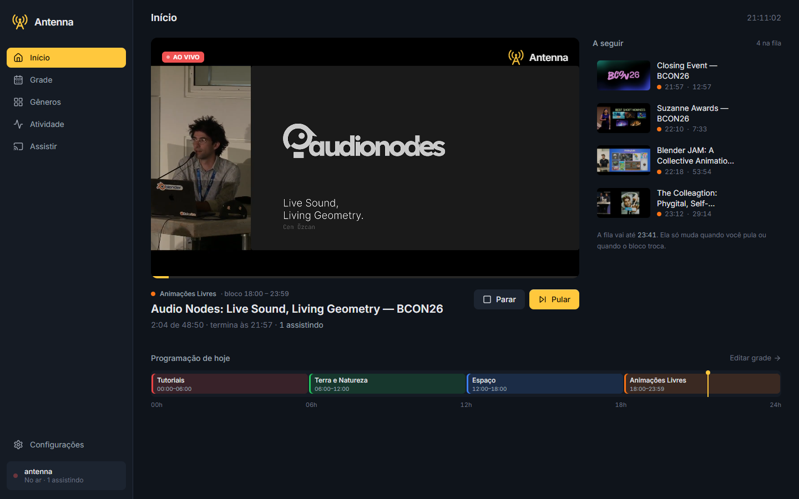
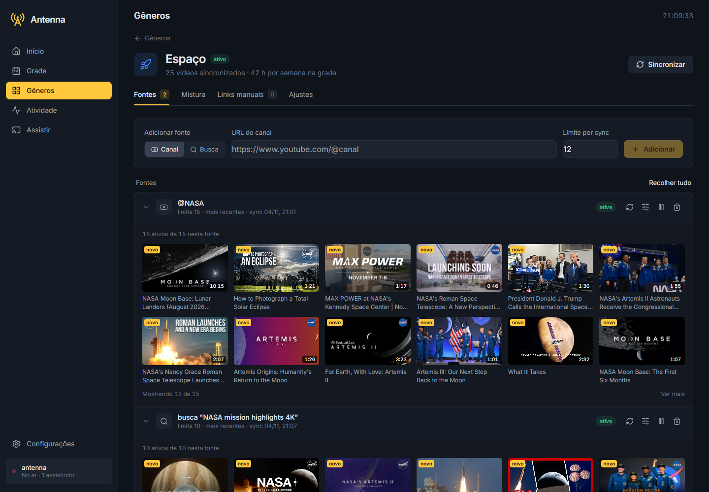
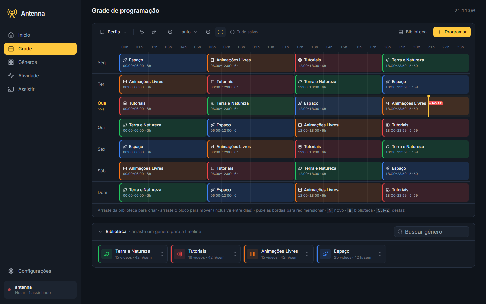
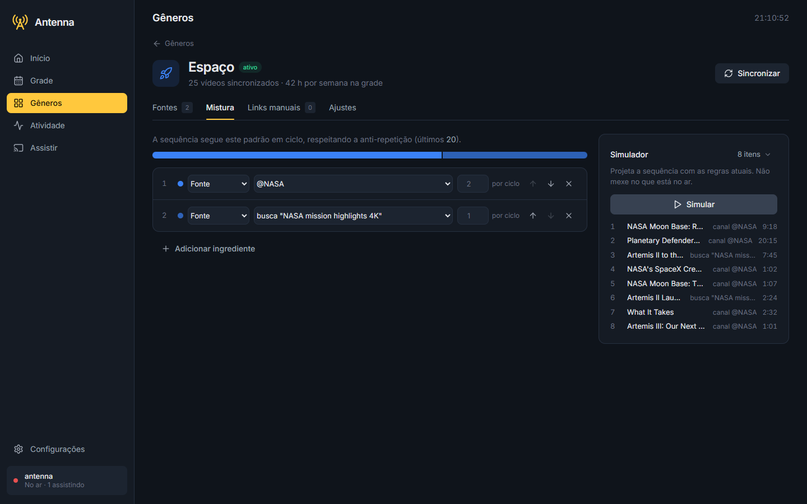
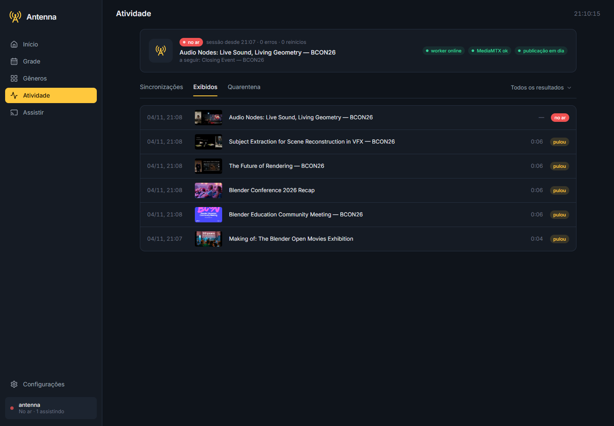
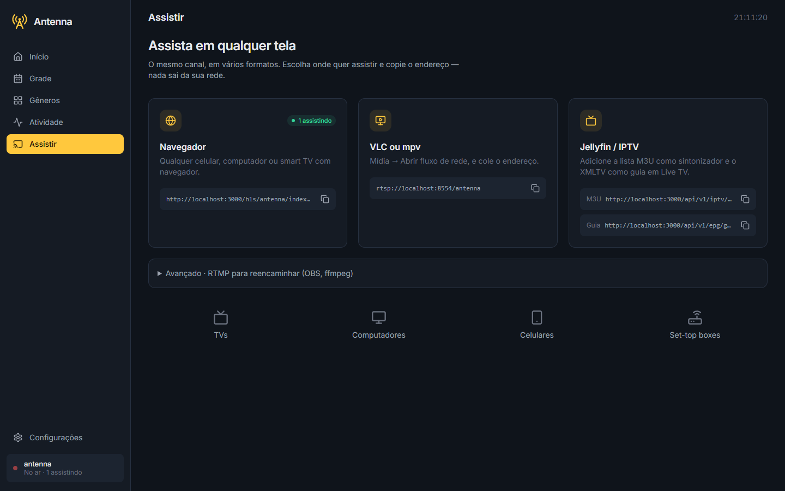
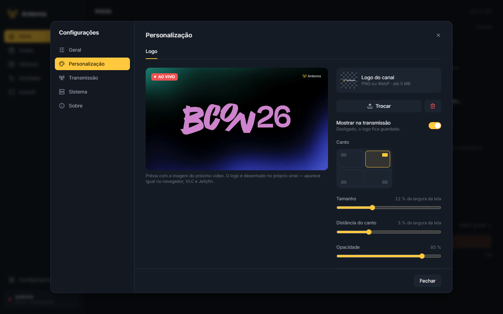

<p align="center">
  
</p>

<h1 align="center">Antenna</h1>

<p align="center">
  <strong>Seu próprio canal de TV, no ar 24 horas, no servidor da sua casa.</strong>
</p>

<p align="center">
  <a href="LICENSE"></a>
  
  
  
  
</p>

<p align="center">
  <a href="docs/installation.md">Instalação</a> ·
  <a href="docs/user-guide.md">Guia do painel</a> ·
  <a href="docs/clients.md">Assistindo</a> ·
  <a href="docs/README.md">Documentação</a> ·
  <a href="CONTRIBUTING.md">Contribuindo</a>
</p>

<p align="center">
  
</p>

---

O **Antenna** transforma vídeos do YouTube e arquivos locais em **um canal de TV linear**
na sua rede. Em vez de escolher o que assistir, você liga o canal: ele decide sozinho o que
vem a seguir, seguindo **gêneros** e uma **grade semanal** que você monta, como uma
emissora de verdade.

O canal abre no navegador, no VLC ou como **TV ao vivo no Jellyfin**, com guia de
programação (EPG). Sobe com um `docker compose up`, guarda tudo num arquivo SQLite e não
tem contas, nuvem nem telemetria.

> [!NOTE]
> Projeto pessoal, de uso doméstico, sem vínculo com o YouTube nem com o `yt-dlp`.
> Leia o [aviso legal](docs/disclaimer.md) antes de usar.

## Recursos

- **Canal linear contínuo**: um vídeo termina e o próximo entra com emenda sem vão,
  24 horas por dia.
- **Gêneros com fontes automáticas**: canais do YouTube, buscas e links avulsos,
  sincronizados sozinhos, além de arquivos locais. Do YouTube, o acervo guarda só
  metadados; nada é baixado.
- **Mistura e anti-repetição**: defina quanto de cada fonte entra na sequência e quantos
  vídeos recentes não podem se repetir, com simulador.
- **Grade semanal**: editor visual com arrastar e soltar, perfis de grade (ex.: "Semana
  normal", "Feriado") e versão para celular.
- **TV ao vivo no Jellyfin**: lista **M3U** e guia **XMLTV** gerado da sua grade. Plex e
  outros clientes IPTV também funcionam (via proxy, no caso do Plex).
- **Logo na transmissão**: marca d'água no próprio sinal, igual em qualquer player.
- **Resiliente**: classifica falhas, repete, coloca vídeos problemáticos em quarentena e
  se recupera sozinho, com histórico e saúde no painel.

## Capturas de tela

<table>
  <tr>
    <td width="50%"></td>
    <td width="50%"></td>
  </tr>
  <tr>
    <td align="center"><sub><b>Gêneros</b> — fontes e acervo com miniaturas</sub></td>
    <td align="center"><sub><b>Grade</b> — programação semanal com arrastar e soltar</sub></td>
  </tr>
  <tr>
    <td width="50%"></td>
    <td width="50%"></td>
  </tr>
  <tr>
    <td align="center"><sub><b>Mistura</b> — receita da sequência e simulador</sub></td>
    <td align="center"><sub><b>Atividade</b> — histórico, falhas e quarentena</sub></td>
  </tr>
  <tr>
    <td width="50%"></td>
    <td width="50%"></td>
  </tr>
  <tr>
    <td align="center"><sub><b>Assistir</b> — navegador, VLC e Jellyfin/IPTV</sub></td>
    <td align="center"><sub><b>Personalização</b> — logo sobre o sinal</sub></td>
  </tr>
</table>

Mais telas e detalhes no [guia do painel](docs/user-guide.md). As capturas usam conteúdo
de canais oficiais e de licença aberta (NASA, Blender, YouTube).

## Início rápido

Você precisa de um host com **Docker** e **Docker Compose v2**.

```bash
git clone https://github.com/michelmlg/antenna.git
cd antenna
cp .env.example .env
docker compose up -d --build
```

Abra `http://<ip-do-servidor>:3000`, crie um gênero, adicione uma fonte, arraste o gênero
para a grade e clique em **Iniciar**. O banco é criado automaticamente no primeiro boot.

| O quê | Endereço |
| --- | --- |
| Painel | `http://<ip>:3000` |
| HLS | `http://<ip>:3000/hls/antenna/index.m3u8` |
| RTSP (VLC) | `rtsp://<ip>:8554/antenna` |
| M3U / XMLTV | `http://<ip>:3000/api/v1/iptv/channels.m3u` · `http://<ip>:3000/api/v1/epg/guide.xml` |

Requisitos de hardware, atualização e remoção estão em [Instalação](docs/installation.md).

## Documentação

| | |
| --- | --- |
| [Instalação](docs/installation.md) | Requisitos, Docker, primeiros passos, atualização |
| [Configuração](docs/configuration.md) | Variáveis do `.env`, portas e fuso horário |
| [Guia do painel](docs/user-guide.md) | Telas, conceitos e como montar a programação |
| [Assistindo ao canal](docs/clients.md) | Navegador, VLC, Jellyfin, Plex e outros clientes IPTV |
| [Operação e manutenção](docs/operations.md) | Backup, atualização do `yt-dlp`, saúde e solução de problemas |
| [Arquitetura](docs/architecture.md) | Componentes, fluxos e decisões de projeto |

## Como funciona, em resumo

```text
Painel (React) ──▶ nginx :3000 ──▶ API (Express) ──HTTP interno──▶ Playout (FFmpeg + yt-dlp)
                       │                 │  ▲                              │
                       │                 ▼  │ estado a cada 5 s            ▼
                       │              SQLite (WAL) ◀────────────────── MediaMTX
                       └──── /hls ──────────────────────────────────────▶ HLS · RTSP
```

A API (controle) e o worker de playout (exibição) são processos separados: reiniciar o
painel nunca derruba o stream. Detalhes em [Arquitetura](docs/architecture.md).

## Stack

[FFmpeg](https://ffmpeg.org/) ·
[yt-dlp](https://github.com/yt-dlp/yt-dlp) ·
[MediaMTX](https://github.com/bluenviron/mediamtx) ·
Node.js + Express · React + Vite + Tailwind · SQLite + Prisma · nginx · Docker Compose

## Contribuindo

Contribuições são bem-vindas. Veja o [guia de contribuição](CONTRIBUTING.md) para montar o
ambiente, rodar as verificações e conhecer as convenções. Encontrou um problema? Abra uma
[issue](https://github.com/michelmlg/antenna/issues). Para vulnerabilidades, siga a
[política de segurança](SECURITY.md).

## Licença

Distribuído sob a licença [MIT](LICENSE). FFmpeg, yt-dlp e MediaMTX são projetos
independentes, cada um com sua própria licença.
