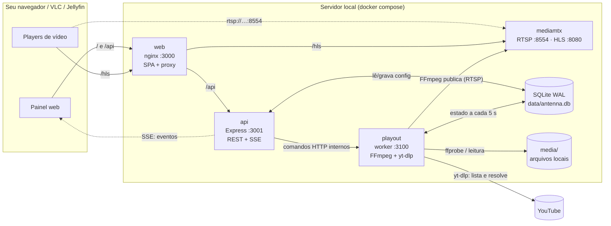
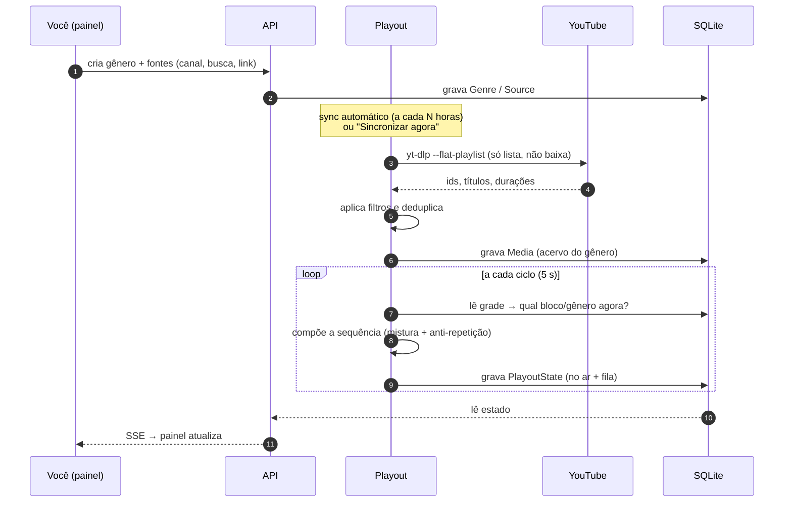
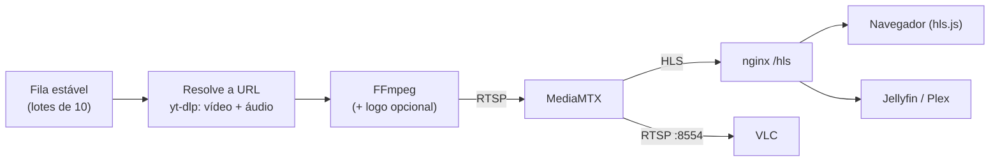

# Arquitetura

Visão técnica de como o Antenna funciona por dentro. Para rodar o projeto, veja
[Instalação](installation.md); para contribuir, [Contribuindo](../CONTRIBUTING.md).

## Visão geral

### Princípios

1. **Controle e exibição separados.** A API (painel e configuração) e o worker de playout
   (FFmpeg e `yt-dlp`) são processos distintos. Reiniciar ou quebrar o painel **nunca**
   derruba o stream; reiniciar o worker não perde o estado do painel.
2. **O banco é o ponto de encontro.** O worker grava o estado do canal a cada ciclo (5 s)
   numa linha única (`PlayoutState`), e a API apenas lê. Comandos (iniciar, parar, pular…)
   vão da API ao worker por HTTP, numa rede interna do compose que não é publicada.
3. **Domínio puro e testado.** Escolha de vídeo, filtros, mistura, grade, EPG e
   classificação de falhas vivem em `packages/core` como funções puras com testes; os apps
   só orquestram I/O.
4. **Contrato único.** Todo input da API é validado por schemas Zod em `packages/shared`,
   e o painel usa os tipos inferidos deles.

## Componentes

| Serviço (container) | Pasta | Papel |
| --- | --- | --- |
| **web** (`antenna-web`) | `apps/web` | Painel em React + Vite + Tailwind servido pelo **nginx**, que também é a porta de entrada (`:3000`): entrega a SPA e faz proxy de `/api` para a API e de `/hls` para o MediaMTX. Tudo na mesma origem, sem CORS. |
| **api** (`antenna-api`) | `apps/api` | API REST + SSE (Express + TypeScript). CRUD de gêneros, fontes, grade, perfis e configurações; empurra eventos em tempo real; gera M3U e XMLTV. É o **único** processo que aplica o schema do banco. |
| **playout** (`antenna-playout`) | `apps/playout` | Worker de exibição: decide o que toca, resolve URLs via `yt-dlp`, roda o FFmpeg e publica no MediaMTX; sincroniza fontes; trata falhas. Sem HTTP público, só um controle interno (`:3100`). |
| **mediamtx** (`antenna-mediamtx`) | `infra/mediamtx.yml` | Servidor de mídia. Recebe o stream do FFmpeg e o distribui como **HLS** e **RTSP**, mantendo o muxer HLS vivo durante as trocas de vídeo. |

Bibliotecas compartilhadas (npm workspaces):

| Pacote | Conteúdo |
| --- | --- |
| `packages/core` | `selection` (mistura, pools, anti-repetição), `filters`, `schedule` (bloco atual), `epg` (XMLTV), `failures` (classificação e quarentena), `branding` (geometria do logo). |
| `packages/shared` | Contrato Zod entre API e Web. |
| `packages/database` | Schema Prisma + client (SQLite em modo WAL). |

## Do conteúdo à fila

## Do vídeo escolhido ao player

1. **Escolha.** A cada ciclo o worker verifica o bloco atual da grade. Havendo bloco, o
   gênero dele monta a sequência (mistura + anti-repetição). Sem bloco, entra a seleção
   automática; sem nada elegível, o _fallback_.
2. **Fila estável.** A sequência é gerada em lotes de 10 e consumida em ordem. Ela só é
   refeita quando o bloco muda, quando esvazia ou no boot, o que evita a "fila que
   embaralha sozinha".
3. **Resolução.** Para vídeos do YouTube, o `yt-dlp` obtém URLs diretas de vídeo e áudio;
   o FFmpeg lê os dois inputs e transcodifica. Arquivos locais em H.264 vão em _copy_.
4. **Publicação.** O FFmpeg publica por RTSP no MediaMTX, que serve HLS e RTSP.
5. **Emenda sem vão.** Na troca de vídeo, o novo FFmpeg assume o caminho antes do anterior
   encerrar, e o MediaMTX mantém o muxer HLS vivo (`hlsAlwaysRemux`): quem está assistindo
   não toma 404 nem reconecta.

## Tempo real no painel

O worker grava o estado a cada ciclo; a API detecta mudanças e emite eventos por **SSE**
(`/api/v1/events`). O painel (TanStack Query) invalida só as consultas afetadas, sem
polling agressivo. Como o estado está no banco, o painel **sobrevive** a reinícios do
worker.

## Tratamento de falhas

As falhas são classificadas em `packages/core/failures.ts`:

| Tipo | Exemplo | Reação |
| --- | --- | --- |
| `sink_unreachable` (infra) | MediaMTX fora do ar, sem rede | Repete o **mesmo** item; nunca vai para quarentena |
| `source_forbidden`, `source_unresolvable`, `input_died` (vídeo) | 403, bot-check, input morreu | Até 3 tentativas; depois quarentena de 24 h (em memória) |
| Transitória | `Read error`, `Stream ends prematurely` | Só log; a retomada por _Range_ recupera |

Um disjuntor deixa o container `unhealthy` após falhas seguidas de publicação no MediaMTX.

## Decisões de projeto

| Tema | Decisão | Por quê |
| --- | --- | --- |
| Topologia | Dois processos: `api` (controle) e `playout` (exibição) | Mexer no painel nunca derruba o stream |
| Banco | SQLite + Prisma em modo WAL | Zero infraestrutura extra; dois escritores coexistem bem em escala doméstica |
| Schema | Só a `api` roda `prisma db push`; o `playout` espera ela ficar `healthy` | Evita dois processos migrando o mesmo SQLite |
| Comunicação | Comandos por HTTP interno; estado pelo banco | Painel à prova de reinício do worker, sem fila de mensagens |
| Tempo real | SSE em vez de WebSocket ou polling | Fluxo unidirecional, simples de proxiar no nginx |
| Fila | Lotes estáveis de 10, consumidos em ordem | A fila exibida é a fila real; nada reordena sozinho |
| Grade | Geometria em minutos (`dia × 1440 + início`); blocos ≥ 5 min, sem cruzar a meia-noite, sem sobreposição (409) | Regras simples e verificáveis, iguais na API e na UI |
| Acervo | Só metadados via `yt-dlp --flat-playlist`; nada é baixado | Disco mínimo; o vídeo é resolvido na hora de ir ao ar |
| Saída | MediaMTX como servidor de mídia | HLS e RTSP prontos, muxer contínuo entre vídeos |
| Front door | nginx serve SPA, `/api` e `/hls` na mesma origem | Sem CORS; uma única porta para abrir |
| Front-end | React + Vite + Tailwind com tokens próprios | Veja o [design system](design-system.md) |
