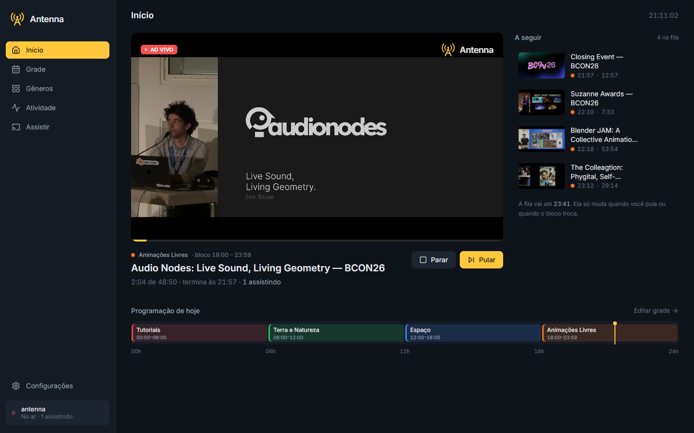
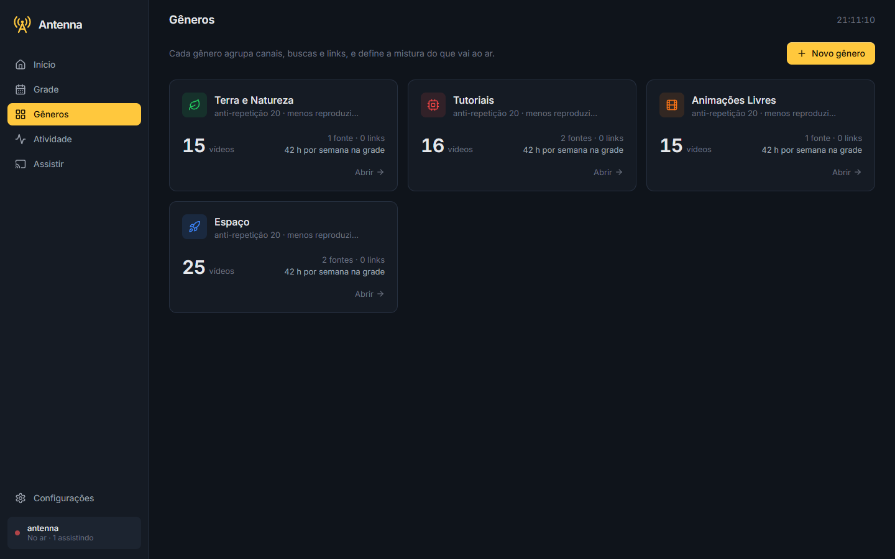
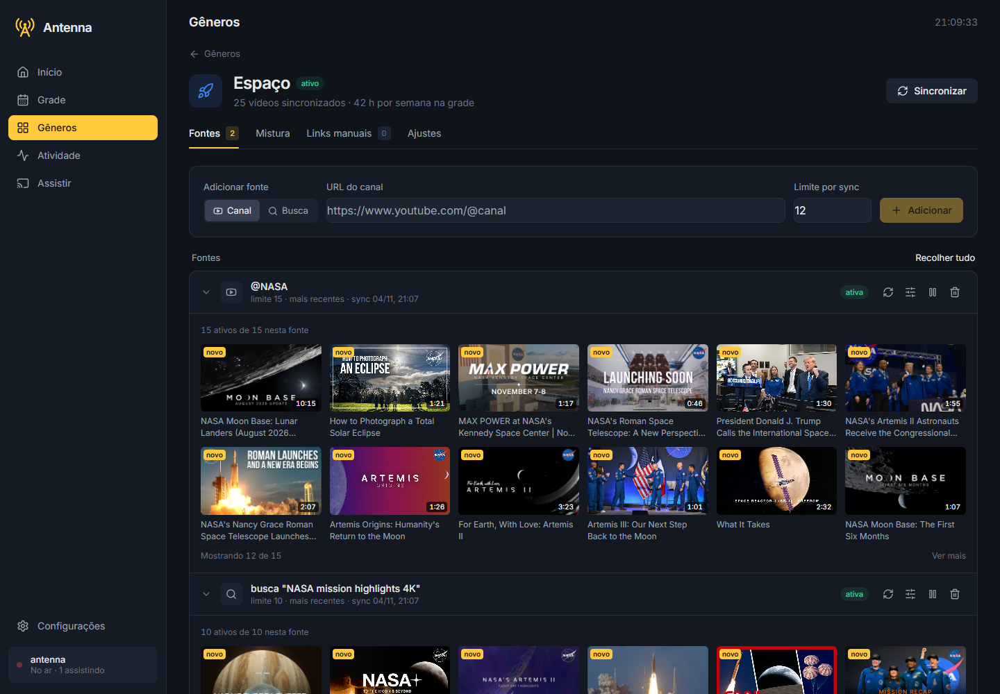
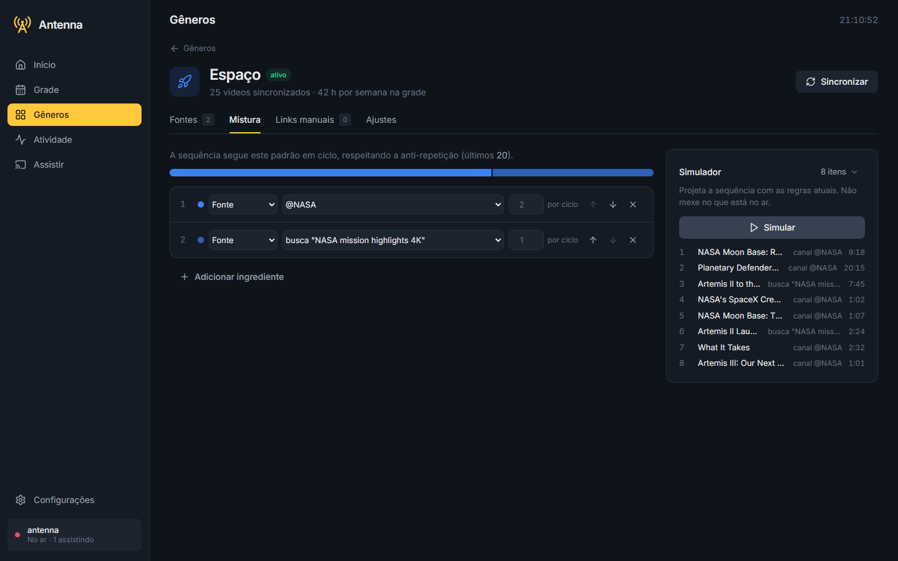
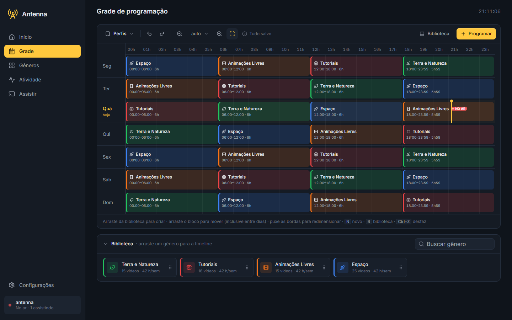
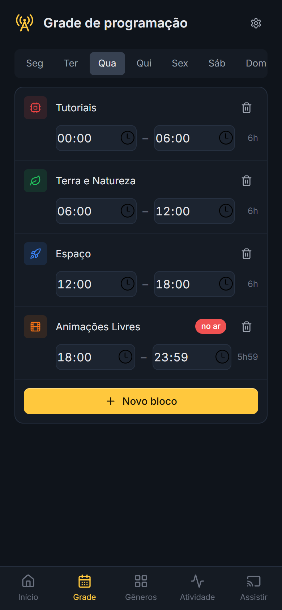
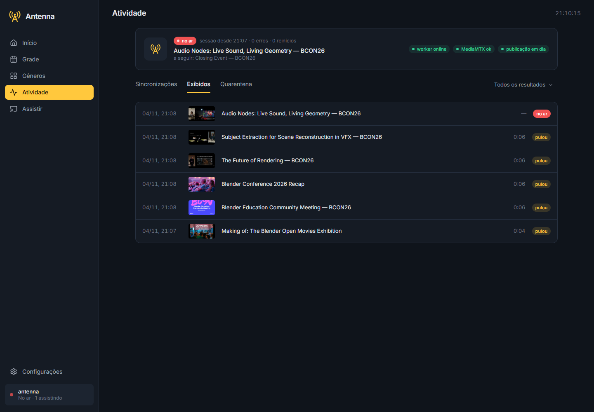
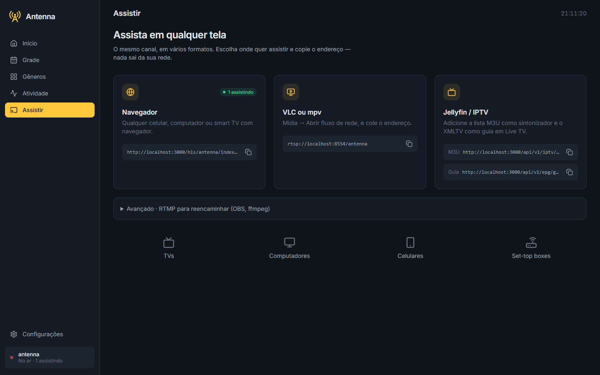
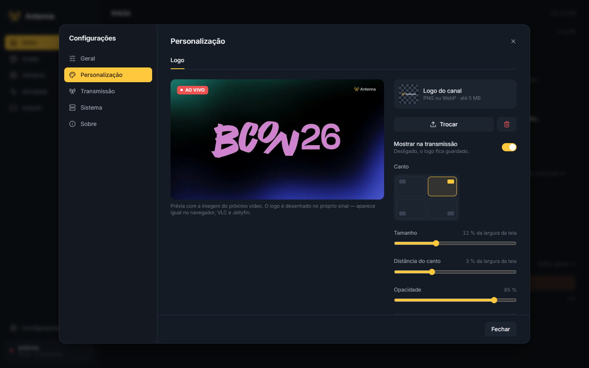

# Guia do painel

O painel web é onde você monta e opera o canal. Ele abre em `http://<ip-do-servidor>:3000`
e funciona no computador e no celular.

> As capturas usam conteúdo de canais oficiais e de licença aberta (NASA, Blender,
> YouTube), apenas para ilustração.

## Conceitos

| Conceito | O que é |
| --- | --- |
| **Gênero** | Um "canal temático" do acervo, com nome, cor, ícone, ordenação padrão e janela anti-repetição. |
| **Fonte** | De onde vêm os vídeos de um gênero: **vídeo avulso**, **canal**, **busca** ou **busca dentro de um canal**. Cada fonte tem limite por sincronização, ordem (recentes/antigos) e filtros. |
| **Filtros** | Palavras no título (incluir/excluir), duração, visualizações, data de publicação, sem Shorts, sem lives. |
| **Mistura** | A "receita" da sequência: quantos vídeos vêm de cada fonte, categoria ou do gênero todo antes de recomeçar o ciclo. |
| **Ordenação** | `menos_reproduzidos`, `aleatoria`, `mais_antigos` ou `definida` (ordem manual). |
| **Anti-repetição** | Quantos vídeos recentes não podem voltar ao ar. |
| **Bloco** | Um intervalo da grade (dia da semana + horário) ligado a um gênero. Mínimo de 5 minutos, sem cruzar a meia-noite, sem sobreposição. |
| **Perfil de grade** | Um conjunto completo de blocos (ex.: "Semana normal", "Feriado"). Aplicar um perfil substitui a grade inteira. |
| **Fallback** | Mídia de segurança para quando não há nada elegível. |
| **Quarentena** | Afastamento temporário (24 h) de um vídeo que falhou repetidamente. O vídeo nunca é apagado. |

Fora dos blocos da grade, o canal usa a **seleção automática** entre os gêneros ativos.

## Início

O centro de operação do canal:

- **Player ao vivo** com o selo _AO VIVO_ e o logo da transmissão (se ligado).
- **No ar**: título, gênero, bloco atual, progresso e quantas pessoas estão assistindo.
- **A seguir**: a fila dos próximos vídeos, com miniatura e horário previsto.
- **Programação de hoje**: régua do dia com os blocos e a marcação de "agora".
- Controles **Iniciar/Parar** e **Pular**.

A fila é **estável**: ela só muda quando você pula, quando o bloco da grade troca ou quando
esvazia.

## Gêneros

A lista mostra cada gênero com cor, ícone, total de vídeos, número de fontes e quantas
horas por semana ele ocupa na grade. A tela de um gênero tem quatro abas.

### Fontes

Adicione canais, buscas ou links e sincronize. Cada fonte expande para mostrar o acervo
com miniaturas. A partir dele você pode **colocar um vídeo no ar agora**, remover ou
reativar vídeos e ajustar os **filtros** da fonte.

O sync só lê metadados (título, duração, miniatura) via `yt-dlp`. **Nada é baixado.**

### Mistura

Defina a receita do gênero (ex.: 2 vídeos do canal da NASA, 1 da busca) e use o
**simulador** para ver a sequência projetada sem mexer no que está no ar.

### Links manuais e Ajustes

- **Links manuais**: vídeos avulsos em ordem definida por você.
- **Ajustes**: nome, cor, ícone, ordenação padrão, janela anti-repetição e status
  (ativo/pausado).

## Grade

Editor visual da semana:

- Arraste um gênero da **Biblioteca** para criar um bloco; arraste o bloco para mover
  (inclusive entre dias) e puxe as bordas para redimensionar.
- Encaixe de 5 em 5 minutos; sobreposições são destacadas e **nunca são salvas**.
- **Perfis**: salve a grade atual como perfil e aplique outro com um clique.
- Desfazer/refazer (`Ctrl+Z`), zoom e atalhos (`N` novo bloco, `B` biblioteca).

  

No celular, a grade vira uma lista por dia, com edição de horários.

> [!NOTE]
> Mudanças na grade valem a partir do próximo ciclo do worker (5 s). O vídeo em exibição
> **não é interrompido**: a fila só é refeita quando o bloco muda.

## Atividade

- **Saúde do canal**: worker, MediaMTX e publicação do estado.
- **Sincronizações**: o resultado de cada sync de fonte.
- **Exibidos**: histórico do que foi ao ar (exibido, pulado, falhou), com a causa
  classificada de cada falha.
- **Quarentena**: vídeos afastados temporariamente, com opção de liberar.

## Assistir

Os endereços prontos para copiar: navegador (HLS), VLC/mpv (RTSP), Jellyfin/IPTV (M3U +
XMLTV) e RTMP para reencaminhar o sinal. Veja [Assistindo ao canal](clients.md).

## Configurações → Personalização

Coloque um **logo sobre a transmissão** (PNG ou WebP): canto, tamanho, distância da borda
e opacidade, com prévia fiel. O logo é desenhado no próprio sinal, então aparece igual em
qualquer player. Vem com o logo do Antenna carregado e **desligado** por padrão.
